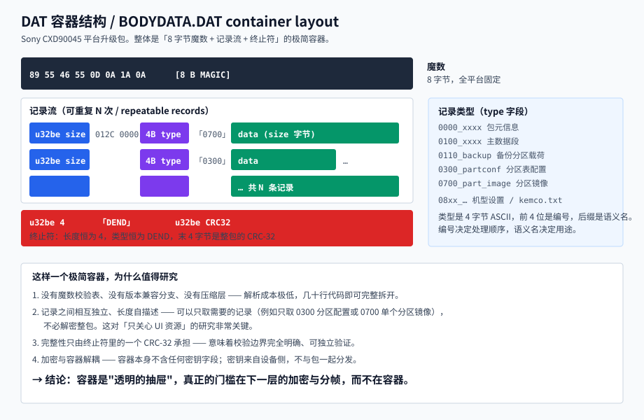
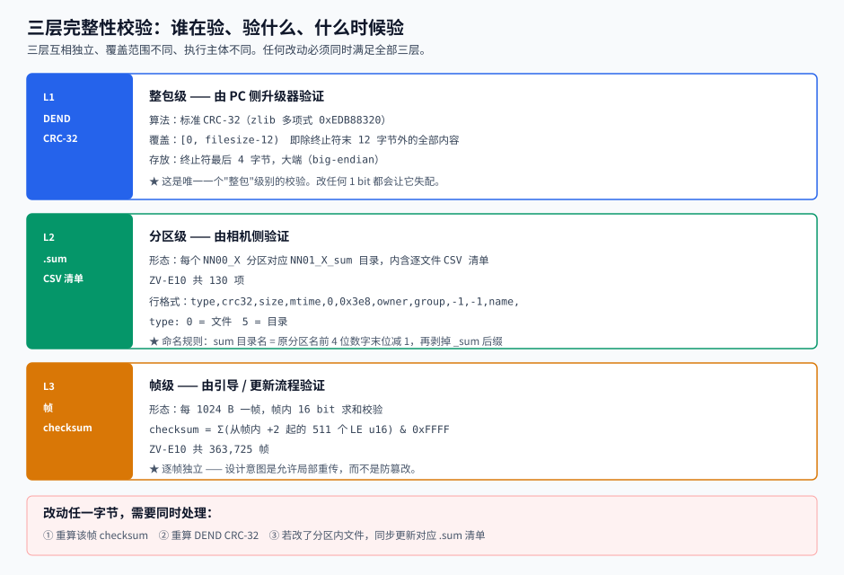
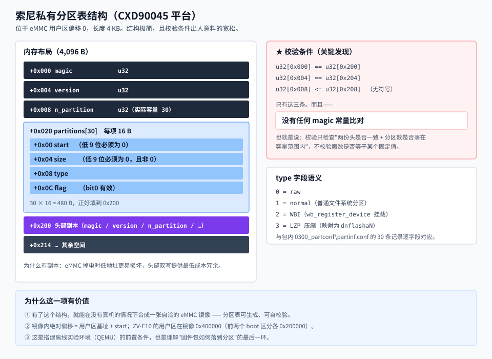
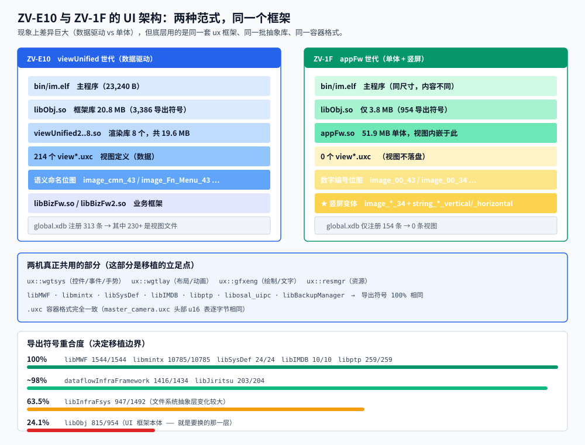
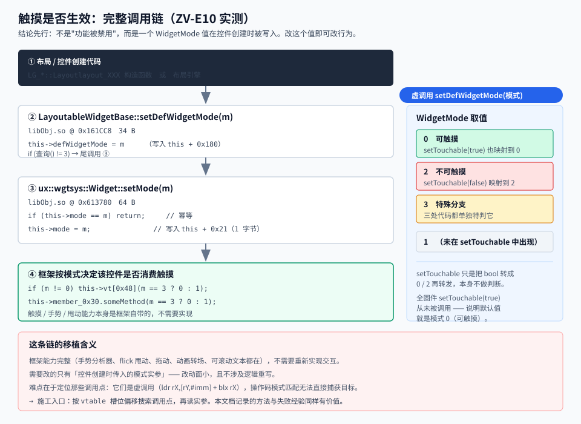
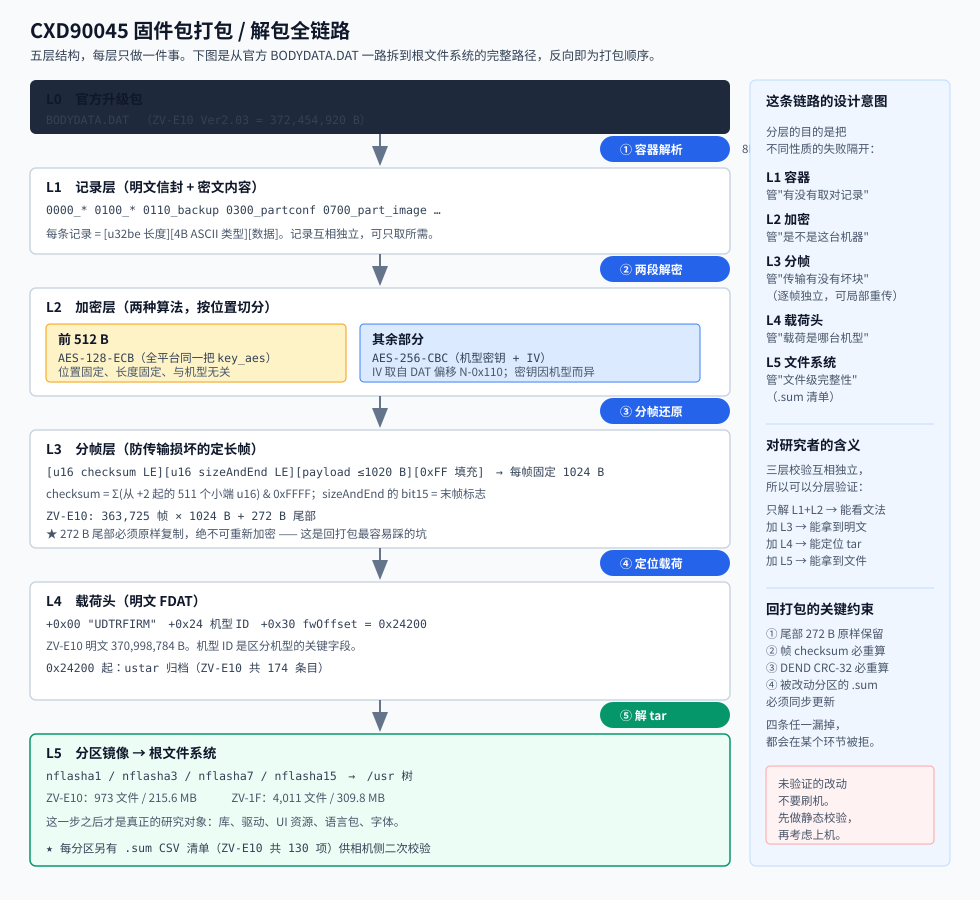

# CXD90045-FPSU 

**Sony CXD90045 平台固件包结构研究，以及 ZV-1F → ZV-E10 的 UI 交互移植可行性分析。**

> 两个机型：ZV-1F（`SYSASTRA-DSC` / `YT`）与 ZV-E10（`SYSASTRA-DSLR` / `RK`）。
> 两者同为 **CXD90045**（Astra，4× Cortex-A5，即 BIONZ X）。
>
> 本仓库发布的是**格式与机制的研究结论、自写工具源码、自制示意图**。
> **不含任何索尼固件、二进制、界面资源、设备转储或密钥。**
> 使用前请先读 DISCLAIMER.txt。

---

## 先读这一节

| 事项 | 说明 |
|---|---|
| **本仓库不含固件** | 分析所需的 `BODYDATA.DAT` 必须由你自行从合法来源取得 |
| **本仓库不含密钥** | 文档只描述密钥的用途、长度、在结构中的位置与解密流程，**不含密钥字节** |
| **本仓库不含反编译导出** | 只发布结论与机制描述；必要的少量反汇编引用仅用于说明机制 |
| **没有人在真机上验证过移植** | 本项目**没有实施** UI 移植。所有可行性判断都标注了依据与置信度 |
| **刷机有真实风险** | 相机可能变砖。若你打算动手，请先做静态校验，再考虑上机 |
| **不提供完整重打包流程** | 只描述结构与失效模式，不提供端到端产出可刷写固件的能力 |

法律与责任边界见 `DISCLAIMER.txt`。

---

## 这个仓库想回答的问题

Sony 的摄像机固件是一个**五层嵌套包**。要研究 UI，得先能完整拆开它。

拆开之后发现一个有意思的事实：

> **ZV-E10 与 ZV-1F 的 UI 架构看起来完全不同，
> 但底层用的是同一套 `ux` 框架、同一批抽象库、同一种资源容器格式。**

于是问题变成：**能不能把 ZV-1F 那套更新的交互体验，搬到 ZV-E10 上？**

这个仓库就是围绕这个问题的工作记录 —— 包括走过的弯路。

---

## 核心发现

### 1. DAT 容器：一个极简却完整的递归结构

```
89 55 46 55 0D 0A 1A 0A            <- 8 B 魔数
[u32be size][4B ASCII type][data]   <- 记录，可重复 N 次
[u32be 4]["DEND"][u32be CRC32]      <- 终止符
```

记录类型是 4 字节 ASCII，前 4 位编号决定顺序，后缀是语义名：
`0000_*` 元信息、`0100_*` 主数据、`0110_backup` 备份载荷、
`0300_partconf` 分区配置、`0700_part_image` 分区镜像、`08xx_*` 机型设置。

**为什么值得研究**：记录长度自描述、互相独立 —— 可以**只取需要的记录**而不解密整包。
对"只关心 UI 资源"的研究，这一点极大降低了成本。



### 2. 加密与容器解耦，按位置切分两种算法

| 区间 | 算法 | 说明 |
|---|---|---|
| 前 512 B | AES-128-ECB | 全平台一把 `key_aes`，位置与长度固定，与机型无关 |
| 其余部分 | AES-256-CBC | 机型密钥 + IV；IV 取自 DAT 偏移 `N-0x110` |

**容器本身不含任何密钥字段** —— 密钥来自设备侧，不与包一起分发。
这正是本项目不发布密钥的原因：它们不属于包结构的一部分。

### 3. 分帧层：为传输可靠性设计，不是为防篡改

```
[u16 checksum LE][u16 sizeAndEnd LE][payload <=1020 B][0xFF 填充]   每帧固定 1024 B
```

- `checksum` = 求和（从帧内 `+2` 起的 511 个小端 u16）& `0xFFFF`
- `sizeAndEnd` 的 bit15 = 末帧标志
- ZV-E10：363,725 帧 × 1024 B + **272 B 尾部**

> **尾部 272 B 必须原样复制，绝不可重新加密。**
> 这是回打包时最容易踩的坑 —— 它不在帧流里，不参与帧校验，但被后续环节使用。

### 4. 三层完整性校验，覆盖范围与执行主体各不相同



| 层 | 范围 | 形态 | 执行者 |
|---|---|---|---|
| L1 | 整包 | DEND 处的 CRC-32（覆盖 `[0, filesize-12)`，大端） | PC 升级器 |
| L2 | 分区内逐文件 | `NN01_X_sum` 目录下的 CSV 清单（ZV-E10 共 130 项） | 相机 |
| L3 | 每 1024 B 帧 | 16 bit 求和 | 引导 / 更新流程 |

改动任一字节，需要同时处理三层 —— 细节见 `docs/02-integrity-checks.md`。

### 5. 索尼私有分区表：校验条件出人意料的宽松



位于 eMMC 用户区偏移 0，长 4 KB。头部在 `+0x000` 与 `+0x200` 双写，30 个分区项各 16 B。

**校验只有三条**：

```
u32[0x000] == u32[0x200]
u32[0x004] == u32[0x204]
u32[0x008] <= u32[0x208]      （无符号）
```

**没有 magic 常量比对。** 也就是说，校验只检查"两份头是否一致 + 分区数是否落在容量范围内"。

`type` 语义：`0`=raw、`1`=normal、`2`=WBI（`wb_register_device`）、`3`=LZP 压缩（映射为 `dnflashaN`）。
与包内 `0300_partconf/partinf.conf` 的 30 条记录逐字段对应。

**这一项的价值**：有了它，就能在**没有真机**的情况下合成一张自洽的 eMMC 镜像。

### 6. 底层 ABI 几乎完全一致 —— 移植边界由此确定

对两机 `.so` 的导出符号做了逐项比对：

| 库 | ZV-1F | ZV-E10 | 重合度 |
|---|---|---|---|
| `libmintx.so` | 10785 | 10785 | **100%** |
| `libMWF.so` | 1544 | 1544 | **100%** |
| `libSysDef.so` | 24 | 24 | **100%** |
| `libIMDB.so` / `libptp.so` / `libosal_uipc.so` / `libBackupManager.so` / `libOnDemandLoader.so` / `libInfraAccessLog.so` | — | — | **全 100%** |
| `dataflowInfraFramework.so` | 1434 | 1416 | 98.7% |
| `libJiritsu.so` | 204 | 207 | 98.1% |
| `libInfraFsys.so` | 1492 | 1091 | 63.5% |
| **`libObj.so`** | 954 | 3386 | **24.1%** |

**结论：分辨率极高。** 底层（MWF / mintx / SysDef / IMDB / ptp / osal / Backup）一行不用动；
要换的只有 UI 层 —— 也就是 `libObj` 那 24.1%。

### 7. UI 架构是两种范式，但共用一个框架



| | ZV-E10 | ZV-1F |
|---|---|---|
| 视图定义 | **214 个 `view*.uxc`**（数据驱动） | **0 个**（内嵌在 `appFw.so` 51.9 MB） |
| 渲染库 | `viewUnified2..8.so` 共 19.6 MB | 无 |
| 框架 | `libObj.so` 20.8 MB | `libObj.so` 3.8 MB |
| 位图命名 | 语义式 `image_cmn_43` | 数字式 `image_00_43` |
| 竖屏支持 | 无 | **有**（`image_*_34` + `string_*_vertical/_horizontal`） |
| 资源注册 | `global.xdb` 313 条（含 230+ 视图） | 154 条（**0 视图**） |

**容器格式没变** —— `master_camera.uxc` 的头部 u16 索引表在两机上**逐字节相同**。
这意味着一方的解析工具可以直接用于另一方。

### 8. 触摸是否生效：不是"被禁用"，而是一个模式值



```
布局/控件创建代码
   |  setDefWidgetMode(模式实参)          <- 虚调用
   v
LayoutableWidgetBase::setDefWidgetMode(m)
   |  this->defWidgetMode = m             (this + 0x180)
   |  if (查询() != 3)
   v
ux::wgtsys::Widget::setMode(m)
   |  this->mode = m                      (this + 0x21, 1 字节)
   v
框架按模式决定该控件是否消费触摸
```

`WidgetMode` 语义：**`0` = 可触摸、`2` = 不可触摸、`3` = 特殊分支**。

三个反直觉的实测事实：

1. **`setTouchable(true)` 在全固件里从未被调用**。仅有的调用点全部传 `false`。
2. **`PAS_MenuSelectMode` 没有任何事件重写** —— 它只是菜单数据持有者，不是触摸实现者。
3. **框架的触摸/手势能力是完整的**：`GestureAnalyzer`、`calcLocalFlickSpeed`（甩动）、
   `setDragHoldPos`（拖动）、`WidgetLayouter`（动画转场）、可滚动文本，都在。

**结论：要改的是"控件创建时传入的模式实参"，不是重写交互。**

### 9. 虚拟机复现：比预期乐观

参考了 [chocotan/a7c2-re](https://github.com/chocotan/a7c2-re)（A7C II，固件 2.01）的做法。
他们用 **「软件 GPE 模型 + QEMU ramfb（fw_cfg DMA）」** 把**原固件菜单真实跑起来并可操作**，
窗口画布与原应用快照**逐像素一致** —— 关键在于**不模拟 GPU**。

方法论可迁移的部分：ramfb 输出、Sony LZ77 用 CPU 同格式解码替代、原 Fsys 虚拟磁盘。
必须重写的部分：**GPE 绘图请求的编码**（ZV-E10 的图形栈不同代）。
**不适用**的部分：CP 启动（ZV-E10 是单 SoC，没有 CP）。

> 但要记住：QEMU 对移植工作的价值是**"能观察 UI 层的文件/ioctl/属性访问"**，
> 不是替代实机验证手感。**实机仍然需要。**

---

## 完整解包链路



五层结构，每层只做一件事，反向即为打包顺序。
逐层说明见 `docs/01-format-dat-container.md`。

---

## 仓库结构

```
.
├── README.md
├── DISCLAIMER.txt          使用前提，务必先读
├── LICENSE                 MIT 许可（逐字，无附加条款）
├── NOTICE                  许可适用范围声明（MIT 不管哪些东西）
├── CONTRIBUTING.md         贡献规则：什么可以提交、什么绝对不行
├── .gitignore              第 1 层：安全排除（固件 / 二进制 / 密钥 / 资源）
├── .gitattributes          第 2 层：危险类型标记 binary
├── .githooks/
│   └── pre-commit          第 3 层：提交前硬失败检查
├── docs/
│   ├── 01-format-dat-container.md    容器 / 加密 / 分帧 格式
│   ├── 02-integrity-checks.md        三层校验与 .sum 规则
│   ├── 03-partition-table.md         私有分区表
│   ├── 04-ui-architecture-diff.md    两机 UI 架构差异
│   ├── 05-touch-callchain.md         触摸调用链与 WidgetMode
│   └── 06-notes-and-pitfalls.md      教训与踩过的坑
├── diagrams/               自制 SVG 示意图（6 张）
└── tools/
    ├── README.md           工具说明与用法
    └── src/                工具源码
```

---

## 现状

### 已完成

- [x] DAT 容器完整解析（记录流 + 终止符）
- [x] 两段解密流程确定（ECB 段 + CBC 段）
- [x] FDAT 分帧还原（帧格式 + 尾部处理）
- [x] ustar 归档提取（174 条目）
- [x] 三层完整性校验全部确定，可重算
- [x] 索尼私有分区表破解（含合成自校验样例）
- [x] 两机全树文件级差异对比（4,011 vs 973 文件）
- [x] 两机导出符号级 ABI 对比
- [x] `.uxc` / `.xdb` 容器格式识别
- [x] 触摸调用链完整反向（`setDefWidgetMode` -> `setMode` -> `Widget+0x21`）
- [x] 虚拟机复现可行性重新评估

### 未完成

- [ ] **UI 移植本身 —— 未实施**
- [ ] **重打包工具不随仓库发布**（做过往返验证，但按设计取舍不公开）
- [ ] `.uxc` 内部偏移表的完整语义（值不是文件偏移，需加载器确认）
- [ ] `.uxb` 文件的作用
- [ ] `WidgetMode` 各调用点的实参清单（施工图）
- [ ] QEMU 环境搭建与 GPE 软件模型
- [ ] 真机验证（从未在硬件上测试过任何修改）

### 探索过但没走通的（同样记录在案）

- **vtable 槽索引定位**：用 Itanium ABI 的 `_ZTI` 指针算出索引 177，
  但按该索引的偏移 `0x2C4` 搜调用点**零命中** —— 说明基址判定有误。
  自校验直方图把真实区间收敛到 **101-112**。方法、失败原因、
  以及为什么操作码扫描对虚调用无效，见 `docs/06-notes-and-pitfalls.md`。

---

## 致谢与先验工作

- [chocotan/a7c2-re](https://github.com/chocotan/a7c2-re) —— A7C II 的 QEMU 原生相机实验与整机转储。
  **本项目的虚拟机可行性判断主要依据其公开的验收结果与方法描述。**
- [ma1co/Sony-PMCA-RE](https://github.com/ma1co/Sony-PMCA-RE) —— Sony 相机 Python 工具箱与 PMCA 协议
- [ma1co/qemu](https://github.com/ma1co/qemu) —— 带 `cxd90045` machine 的 QEMU fork
- [DavidBuchanan314/ILCE-7M4-RE](https://github.com/DavidBuchanan314/ILCE-7M4-RE) —— A7 IV 逆向笔记
- Sony OSS 发布的 Linux 源码（`https://oss.sony.net/Products/Linux/`）

方法论上从中学到的两条，本项目全程遵守：

1. **把"验证通过"和"发送成功"分开** —— 输入命令返回成功，不代表固件处理了对应语义
2. **不要在报告里把未验证的步骤写成已完成** —— 本 README 的"未完成"一节就是为此存在

---

## 许可

本项目自有的文档、工具源码与示意图采用 **MIT** 许可（见 `LICENSE`）。

**MIT 仅覆盖本项目原创内容**，不覆盖索尼固件、索尼二进制、索尼界面资源、
索尼商标或任何第三方内容 —— 详见 `NOTICE`。

> 说明：MIT 是**版权**许可，只处理"复制、修改、分发本作品"。
> 它不处理、也无法处理：规避技术保护措施的法律规定、专利权、
> 或使用者利用这些研究成果所实施的行为。
> 风险提示与行为约定见 `DISCLAIMER.txt`（那是使用前提，不是许可条款）。
